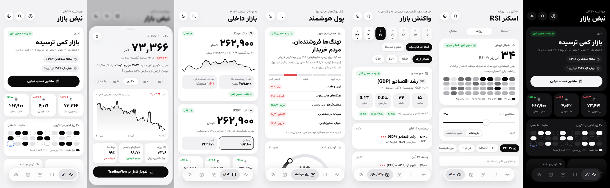

# نبض بازار · اپ اندروید

قیمت زنده‌ی ارز، طلا، سکه، تتر، فارکس، نفت و ارزهای دیجیتال، همراه با پول هوشمند، تقویم اقتصادی و اسکنر RSI.
طراحی به سبک اپ‌های اپل، روشن و تیره. حجم APK حدود ۱۷۰ کیلوبایته.



## بخش‌ها

| بخش | چی داره |
|---|---|
| نبض | حال بازار، سلطه‌ی بیت‌کوین، ۳۰ روز اخیر بیت‌کوین، ترس و طمع، فهرست کریپتو و فارکس و طلا و نفت، ستاره‌دارها، ماشین‌حساب تبدیل |
| داخلی | دلار با نمودار ۳۰ روز، «دلار از روی طلا»، تتر از چند صرافی (ارزون‌ترین مشخص)، طلا، سکه با حباب، ارزها، ماشین‌حساب طلا و سکه |
| پول هوشمند | جمع‌بندی ساده‌ی پنج نشانه، ترس و طمع، نهنگ‌های هایپرلیکوید، معامله‌گرهای برتر بایننس، سرمایه‌ی باز، جریان استیبل‌کوین، نرخ تأمین مالی (فقط کریپتو)، دیفای لاما |
| واکنش بازار | هفته‌ی شمسی، شمارش معکوس خبر بعدی، اثر احتمالی هر خبر روی دلار، طلا، نفت و بیت‌کوین، حرکت واقعی بازار بعد از خبر |
| اسکنر RSI | ۵۰۰ ارز برتر در ۴ ساعته، روزانه و هفتگی؛ تقاطع MACD، جریان پول، آستانه‌ی دلخواه |

**ویجت ورقه‌ای:** یه ویجت ۴×۲ برای صفحه‌ی اصلی گوشی که با کشیدن بالا و پایین ورق می‌خوره. ورق‌ها: تتر (نوبیتکس، والکس، تبدیل)، دلار و طلا، پول هوشمند، کریپتو و ترس و طمع، خبر بعدی، اسکنر RSI. هر ورق از تنظیمات قابل خاموش شدنه. ویجت هر ۱۵ دقیقه قیمت‌های سبک رو خودش می‌گیره و با زدن روی هر ورق همون بخش اپ باز میشه (`StackWidget`، `WidgetService`، `WidgetData`، `WidgetJob`).

روی هر قیمت بزنی، کارت جزئیات با نمودار باز میشه. کارت با کشیدن به پایین بسته میشه. برای به‌روزرسانی، صفحه رو از بالا بکش پایین.

## چرا سریع‌تر از نسخه‌ی وب شده

- درخواست‌ها رو خود اندروید می‌فرسته، پس محدودیت CORS مرورگر نیست. تقویم اقتصادی مستقیم و زیر ۱ ثانیه میاد و دیگه سرور واسطه لازم نیست.
- آخرین قیمت‌ها روی گوشی ذخیره میشن. اپ همون لحظه باز میشه و بعد زنده میشه.
- هر منبع چند مسیر جایگزین داره. اپ یادش می‌مونه با فیلترشکن و بدون فیلترشکن کدوم مسیر جواب داده. اگه یه مسیر کُند باشه، مسیر بعدی هم‌زمان امتحان میشه.
- **اسکنر:** کندل‌های هر ارز روی گوشی می‌مونن. تا کندل تازه باز نشده، اسکن دوباره به‌جای ۳۰۰ درخواست فقط یک درخواست قیمت لحظه‌ای می‌فرسته.
- **نهنگ‌ها:** فهرست کیف‌پول‌ها (جدول ۳۹ مگابایتی هایپرلیکوید) روزی یک بار و پیش‌فرض فقط با وای‌فای گرفته میشه. موقعیت‌هاشون با درخواست‌های چندکیلوبایتی به‌روز میشن.
- فونت داخل خود اپه و تصویر لوگوی ارزها دانلود نمیشه.

## منبع داده‌ها

| داده | منبع | جایگزین |
|---|---|---|
| کریپتو | CoinGecko | تیکر بایننس |
| فارکس، طلا، نفت، شاخص دلار | Cloudflare Worker (`/prices`) | قیمت توکن طلا و نقره در CoinGecko (تقریبی) |
| بازار داخلی | Cloudflare Worker (`/iran`) | سه کپی گیت‌هاب `itsyebekhe/nabz`؛ تازه‌ترینشون انتخاب میشه |
| تتر | نوبیتکس، اکسیر، والکس، بیت‌پین، رمزینکس | بیت‌پین و رمزینکس فقط بدون فیلترشکن جواب میدن |
| کندل‌ها | Binance (data-api.binance.vision و api1/api3) | Bybit، OKX، KuCoin، Gate |
| پول هوشمند | Binance Futures، Hyperliquid، DefiLlama، alternative.me | — |
| تقویم | Forex Factory (faireconomy) | `edri3i.github.io/market-reaction/calendar.json` |

بایننس و هایپرلیکوید ایران رو تحریم کردن؛ این دو بخش با فیلترشکن کار می‌کنن.
آدرس Worker رو میشه توی تنظیمات اپ عوض کرد.

## ساختار

```
app/src/main/java/com/nabz/bazar/   پوسته‌ی اندروید (WebView + درخواست‌های شبکه + حافظه + لرزش)
app/src/main/assets/www/            کل رابط کاربری (HTML/CSS/JS بدون هیچ کتابخونه)
  js/core.js     منبع‌ها، مسیرهای جایگزین، حافظه، اندیکاتورها، اسکنر
  js/ui.js       صفحه‌های اصلی
  js/sheets.js   کارت‌های جزئیات، ماشین‌حساب‌ها، جستجو، تنظیمات
  js/cal.js      منطق تقویم اقتصادی و اثر خبرها
  js/main.js     کنترل اپ
tools/                              اسکریپت تست در مرورگر و ساخت فهرست‌های پیش‌فرض
```

## ساختن APK

**روی گیت‌هاب:** هر بار که کد push بشه، Actions خودش APK رو می‌سازه. فایل از تب Actions، بخش Artifacts دانلود میشه.

**روی کامپیوتر** (JDK 17 و Android SDK لازمه):

```
./gradlew assembleRelease
```

**امضا:** برای اینکه نسخه‌های جدید روی نسخه‌ی قبلی نصب بشن، APK باید همیشه با همون کلید امضا بشه.
- روی کامپیوتر: فایل کلید رو کنار پروژه بذار و یه فایل `keystore.properties` بساز با `storeFile`، `storePassword`، `keyAlias` و `keyPassword`.
- روی گیت‌هاب: دو Secret به اسم `KEYSTORE_BASE64` و `KEYSTORE_PASSWORD` اضافه کن.

کلید و رمزش هیچ‌وقت نباید توی مخزن گذاشته بشن.

## تست رابط کاربری روی کامپیوتر

```
pip install playwright
python tools/test_app.py out home iran smart news rsi
```

داده‌ها فقط برای اطلاع هستن و توصیه‌ی خرید و فروش نیستن.

---

**Nabz Bazar** · Idea — Ali Edrisi · Design — Mohammad Khaledi
